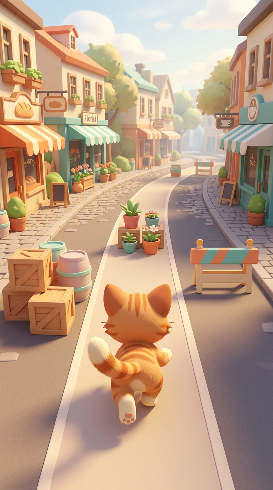

# Cat Dash 🐈

A public **Android Unity starter and Head-agent handoff**, not a finished game.

## The idea
A charming cat runs down a colorful street. Dodge obstacles; collision ends the run.
AI-assisted original art, a clean mobile camera and a small polished playable slice.
Three-lane swipe controls and portrait layout are proposed defaults for Head to confirm.

## Start here
- **[Copy this prompt to Head (বাংলা)](HEAD_HANDOFF_BN.md)**
- [Game brief and acceptance criteria](docs/GAME_BRIEF.md)
- [Agent contract](AGENTS.md) / [Head instructions](agents/HEAD.md)
- [Unity, signing and Play setup](docs/SETUP.md)

Kit revision is recorded in unity-kit.lock.json. Team: Head + Gameplay + Content + QA;
human forwards briefs/reports. Optional [Idea Partner](agents/IDEA.md) for later design discussion.

## Current status
Included: Unity 6000.3.3f1 starter source, minimal physics smoke tests, kit tooling,
manual Unity Android workflow, filled game brief, Head prompt and AI concept art.
**Not implemented:** cat runner gameplay, actual cat/obstacle 3D assets, run animation,
CatDash scene, polished UI or device-tested build. The kit's generic sphere prototype
is not this game. No Unity compilation/tests, Android build or Play upload run here.
No secrets were copied/configured. Configure THIS repo's secrets in GitHub UI yourself.

## Manual checks only
`python3 tool/preflight.py` for cheap source checks. At a useful batch boundary:
**Actions → Unity Android → Run workflow**. Owner controls tests/build/internal upload.
No ads, paid service, production publishing or automatic CI on push.

## Secret readiness
Actions → **Secrets Check** → Run workflow (main) → open Summary for ✅/❌ per expected
secret. No values exposed. Local signing test; optional Google OAuth/Play read check.
Unity activation and Play release permissions remain separate from presence checks.
See docs/SETUP.md. The workflow is manual; no secrets have been changed by adding it.

## Safe kit updates
`python3 tool/kit_update.py --check` reports newer toolkit changes without writing.
Apply only a reviewed full commit with `--apply --ref <full-sha>`; workflow changes
need owner approval. Customized files conflict instead of being overwritten.
See [update guide](docs/UPDATING.md). No automatic sync, push or CI.

## Team names / ভাষা
Head → **Agent A** (Gameplay), **Agent B** (Content/UI), **Agent C** (Reviewer/QA).
Head-এর সব প্রশ্ন, plan, briefs ও reports সহজ বাংলায় হবে। Code, commands, paths ও
secret names অপরিবর্তিত থাকবে। Idea Partner আগের মতো আলাদা planning role।
